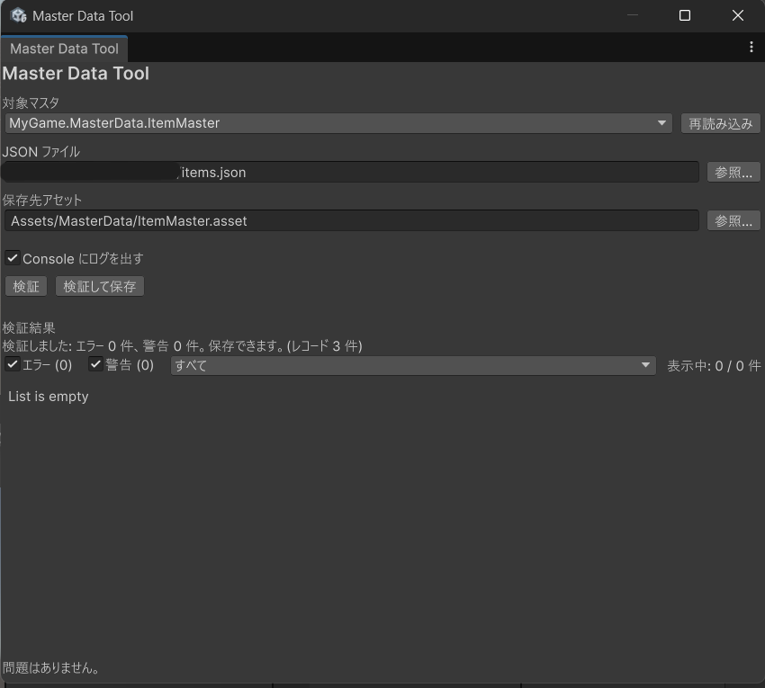
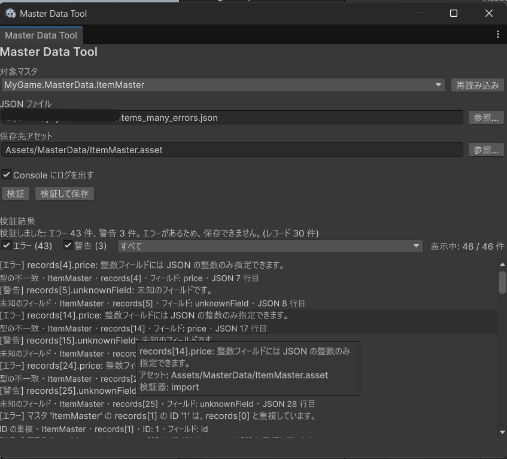
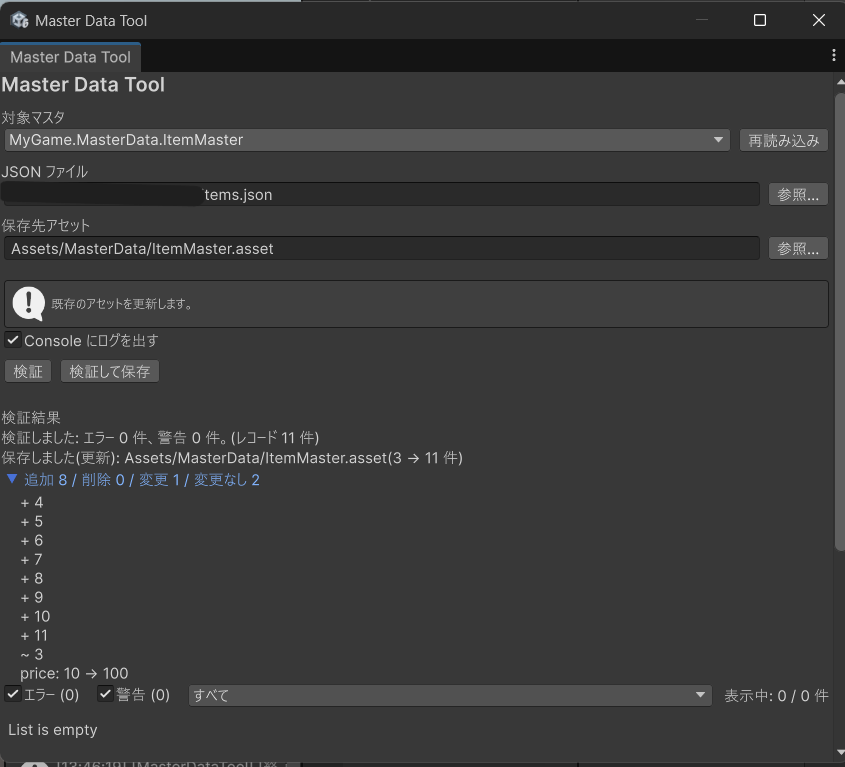

# Master Data Validator

JSON のマスタデータを ScriptableObject に取り込み、ID の重複や参照切れなどの整合性をエディタ上で検証する Unity パッケージです。

## 特長

- JSON を ScriptableObject のマスタアセットへ取り込めます。
- ID の重複、参照切れ、必須項目、型の不一致を検証します。
- 検証結果の一覧から、対応するアセットを選択できます。
- 既存アセットとの差分を表示します。
- 実行の開始と終了を Console に残せます。
- ウィンドウの入力と、ログのオン/オフをプロジェクトごとに保存します。

## スクリーンショット







## 動作環境

- Unity 6000.0 以降
- 依存パッケージ `com.unity.nuget.newtonsoft-json` 3.2.1（Package Manager が追加します）
- EditMode テスト 628 件

## インストール

Package Manager の「Add package from git URL」に、次を入力します。

```
https://github.com/yuya-hatano-abs/Unity-MasterData-Validator.git
```

ローカルのフォルダを参照する場合は、プロジェクトの `Packages/manifest.json` に次のように書きます。パスは、そのプロジェクトからパッケージのフォルダまでの相対パスです。

```json
"com.yuya-hatano.masterdata-validator": "file:../../Unity-MasterData-Validator"
```

## クイックスタート

1. Package Manager でこのパッケージを選び、Samples の「Master Data Sample」を Import します。
2. メニュー `Tools/Master Data Tool/Importer` を開きます。ウィンドウ名は `Master Data Tool` です。
3. 「対象マスタ」で `ItemMaster` を選びます。保存先が空なら `Assets/MasterData/ItemMaster.asset` が入ります。
4. 「JSON ファイル」に、Import した `items.json` のパスを入れます。「参照...」はファイル選択ダイアログで、選んだ絶対パスが入ります。欄は入力文字列をそのまま存在確認と読み込みに渡します。拡張子は `.json` です（大文字小文字は区別しません）。`Assets/` で始まることは要求しません。相対パスをプロジェクトのルートへ変換する処理もありません。
5. 「保存先アセット」は、`Assets/` で始まり `.asset` で終わるプロジェクト相対パスです。絶対パス、バックスラッシュ、末尾や連続の `/`、`..` は使えません。まだファイルが無くても、形式が正しければ指定できます。「検証して保存」を押します。
6. 「対象マスタ」を `QuestMaster` に変え、「JSON ファイル」を `quests.json` にします。保存先が空なら `Assets/MasterData/QuestMaster.asset` が入ります。「検証」を押します。`ItemMaster` のアセットが先に必要なのは、参照先をプロジェクト内のマスタアセットから集めるためです。今回開いている JSON は、検証するマスタそのものに使います。
7. 既存アセットと内容が違う状態で「検証して保存」すると、確認のあと、結果の Foldout に差分が出ます。

サンプル JSON ごとの件数は、[仕様書](Documentation~/Specification.md)の「サンプルの期待結果」にあります。

## マスタ型の作り方

レコードは `IntIdMasterRecord`（整数 ID）か `StringIdMasterRecord`（文字列 ID）を継承します。マスタは `MasterDataBase<TRecord>` を継承します。必須の文字列は `[MasterRequired]`、他マスタの ID は `[MasterRef]` です。次はサンプルと同じ内容です。

```csharp
[Serializable]
public sealed class ItemRecord : IntIdMasterRecord
{
    [SerializeField, MasterRequired] private string name;
    [SerializeField] private int price;

    public string Name => name;
    public int Price => price;
}

[CreateAssetMenu(fileName = "ItemMaster", menuName = "Master Data/Item")]
public sealed class ItemMaster : MasterDataBase<ItemRecord>
{
}

[Serializable]
public sealed class QuestRecord : StringIdMasterRecord
{
    [SerializeField, MasterRequired] private string title;
    [SerializeField, MasterRef(typeof(ItemMaster), NoneValue = 0)] private int rewardItemId;

    public string Title => title;
    public int RewardItemId => rewardItemId;
}
```

`NoneValue = 0` は、その整数を「参照なし」として検査しない指定です。省略すると `0` も参照として検査します。コード生成は、メニューやボタンはなく、エディタ API としてのみ提供します。

## 検証

標準では、ID の重複、参照切れ、必須項目を調べます。型の不一致や未知のフィールドは、JSON の取り込み時に問題として残ります。エラーが 1 件でもあると保存しません。警告だけなら保存できます。種類の一覧と重大度は、[仕様書](Documentation~/Specification.md)にあります。

## 既知の制限

同じ型のマスタアセットが複数ある型は、参照先に使えません。入れ子のクラスと `UnityEngine.Object` 系のフィールドは、インポートに未対応です。フィルターは再コンパイルで初期状態に戻ります。詳細は[仕様書](Documentation~/Specification.md)の「既知の制限」です。

## ライセンス

MIT License です。全文は `LICENSE` を参照してください。
